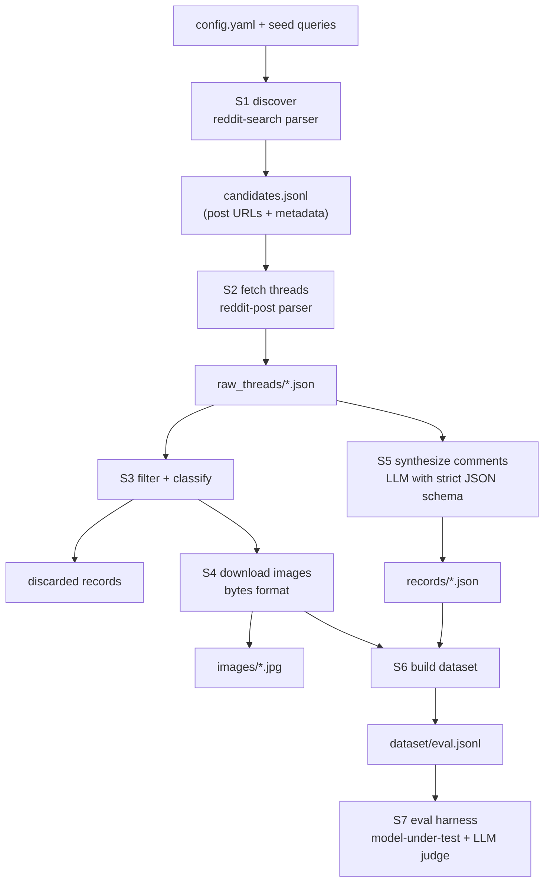

# Implementation Specification: 3D-Print Failure Diagnosis Eval Dataset

## Audience for this document

This document is written to be handed to a coding agent or to a small team of developers as the single source of truth. It specifies what to build, which Context.dev endpoints to call, the exact request bodies, the data schemas, and the acceptance criteria. Any implementation decision not specified here should be raised as a question rather than silently improvised.

## 1. Objective

Build a pipeline that:

1. Discovers forum threads in which users post photographs of failed 3D prints and ask for troubleshooting help.
2. Downloads the failure photographs and captures the accompanying discussion.
3. Synthesizes the community comments into a structured reference entry: defect classification, likely causes, and recommended fixes.
4. Emits an evaluation dataset in which each record pairs an image (plus minimal context) with the synthesized reference diagnosis, suitable for scoring a model's ability to diagnose print failures and propose fixes.

Out of scope: fine-tuning, real-time monitoring of forums, and any public redistribution of scraped images.

## 2. Source selection

### 2.1 Primary source: Reddit

Reddit is the best fit because Context.dev ships prebuilt parsers that return structured posts and the full comment tree, and because r/FixMyPrint is a dedicated troubleshooting subreddit where the majority of posts are photographs of failed prints.

| Subreddit | Role | Notes |
| --- | --- | --- |
| r/FixMyPrint | Primary | Nearly all posts are failed-print photos with troubleshooting comments. The "Solved" flair is a strong ground-truth signal that a fix was identified. |
| r/3Dprinting | Secondary | Use flair "Troubleshooting" to filter; much of the subreddit is prints that succeeded, so filtering matters. |
| r/3Dprintingtech | Tertiary | Lower volume, same approach as r/3Dprinting. |

Discovery queries (extend as needed): `stringing`, `warping`, `layer shift`, `underextrusion`, `bed adhesion`, `first layer`, `spaghetti`, `failed print`, `help`, `what went wrong`, `blobs`, `ghosting`, `z banding`, `clogging`, `pillowing`.

### 2.2 Secondary sources: classic web forums (phase 2, optional)

Prusa forum (forum.prusa3d.com), UltiMaker forum (community.ultimaker.com), RepRap forum (forums.reprap.org). These require the generic scrape path with a custom parser per forum software (Flarum, Discourse, phpBB each need their own CSS rules). Only attempt these after the Reddit pipeline is complete, because per-forum selectors are the highest-maintenance part of any forum scraper.

### 2.3 Excluded sources

Discord servers (Voron, printer vendor servers) are not accessible through this API. Instagram/TikTok parsers exist but are irrelevant here.

## 3. Architecture



Stages communicate only through files on disk (JSONL and JSON). Each stage is an independently runnable CLI command. This keeps the system debuggable by beginners: every intermediate artifact can be inspected with a text editor, and any stage can be rerun without redoing the whole pipeline.

## 4. Environment and credentials

- Language: Python 3.11+. SDK: `pip install context.dev`.
- The SDK reads the key from the environment: `export CONTEXT_DEV_API_KEY="ctxt_secret_..."`. Never hardcode the key, never commit it, never pass it as a CLI flag (shell history and process listings expose it). Use a `.env` file loaded by the code, listed in `.gitignore`.
- All SDK calls retry twice with exponential backoff on connection errors and 408, 409, 429, and 5xx responses; default per-attempt timeout is 60 seconds. Do not wrap calls in additional aggressive retry loops; do handle SDK exceptions and log `request_id`, which every response carries and which support uses to investigate failures.
- Every response also includes `key_metadata` with credits consumed. Log it per run so cost is visible.

Reference documentation used by this spec: Scrape overview (https://docs.context.dev/scrape/overview), Images (https://docs.context.dev/scrape/images), Bytes (https://docs.context.dev/scrape/bytes), JSON extraction (https://docs.context.dev/scrape/json), Custom parser (https://docs.context.dev/scrape/parse-fields), Reddit post parser (https://docs.context.dev/scrape/prebuilt-parsers/reddit-post), Reddit search parser (https://docs.context.dev/scrape/prebuilt-parsers/reddit-search), Search (https://docs.context.dev/search/overview), Map (https://docs.context.dev/map/overview), Crawl (https://docs.context.dev/crawl/overview), Batches (https://docs.context.dev/batches/overview), SDKs (https://docs.context.dev/sdks), Credits (https://docs.context.dev/account/credits).

## 5. Stage specifications

### S1: Discovery (`discover.py`)

Use the prebuilt Reddit search parser against each subreddit and each query. The parser accepts a Reddit search URL; sort by `top` with `t=all` to prioritize threads where the community actually engaged, and set a limit per query (start with 100, max 1,000).

Request body for each (subreddit, query) pair:

```json
{
  "url": "https://www.reddit.com/r/FixMyPrint/search?q=stringing&sort=top&t=all&restrict_sr=1",
  "formats": { "parse": true },
  "parseParams": { "type": "prebuilt", "parser": "reddit-search", "limit": 100 }
}
```

Python SDK form:

```python
page = client.web.scrape(
    url=search_url,
    formats={"parse": True},
    parse_params={"type": "prebuilt", "parser": "reddit-search", "limit": 100},
)
posts = page.parsed.data.posts
```

Filter at discovery time to conserve credits:

- `post.type` in `{"image", "gallery"}` (link posts are rarely failure photos; text posts have no image).
- `post.comment_count >= 5` (a synthesis needs material to work from).
- `post.score >= 10` (removes low-effort threads).
- Drop `is_nsfw: true` and `removed_by` non-null.

Write each surviving post to `candidates.jsonl` keyed by `post.id`. Deduplicate on `post.id` across queries. Also store `flair`, `title`, `upvote_ratio`, and `comment_count` for later filtering.

Successive pages: the parser returns `has_more`; paginate by increasing `limit` per request rather than issuing many small requests. Sorting by `new` with `t=year` is a second discovery pass to catch recent threads that `top` misses.

### S2: Thread fetch (`fetch.py`)

For each candidate, fetch the full thread with the prebuilt Reddit post parser. Use `?sort=top` on the URL so the most valuable comments arrive first, and `limit: 200` initially (max 1,000; comments are filled shallowest-first, so a limit keeps whole top-level conversations).

```json
{
  "url": "https://www.reddit.com/r/FixMyPrint/comments/{id}?sort=top",
  "formats": { "parse": true },
  "parseParams": { "type": "prebuilt", "parser": "reddit-post", "limit": 200 }
}
```

The response in `parsed.data` contains:

- `post`: title, body (Markdown), `images` (array of `{url, width, height, caption}` for gallery posts, in order), flair, score, `upvote_ratio`, timestamps.
- `comments`: a nested tree of `RedditThreadComment` with `body` (Markdown), `score`, `depth`, `parent_id`, `is_submitter`, `is_deleted`, and `replies`.

Store the raw parsed response verbatim as `raw_threads/{subreddit}_{post_id}.json`. Never reformat or trim at this stage; filtering happens downstream so raw data is never lost.

For volume above roughly 200 threads, use Batches instead of a per-URL loop: submit all thread URLs as one asynchronous job with `input.mode: "scrape"` and the same `formats.parse` / `parseParams` per URL, then read paginated results. Batches support the same per-page formats and parameters as Scrape, return a `batch_id` immediately, reserve credits up front, and expose `input.reserved` / `credits.reserved` for cost tracking. Use an `Idempotency-Key` so a retried submission does not double-spend.

### S3: Filtering (`filter.py`)

Apply post-level and image-level gates, and record the reason for every rejection.

Post-level accept criteria:

1. At least one image in `post.images` with `width >= 400` and `height >= 300` (small thumbnails are unusable for visual diagnosis).
2. Title or body matches the failure lexicon (regex list: stringing, warping, warp, layer shift, shifting, under[- ]?extrusion, over[- ]?extrusion, adhesion, not sticking, first layer, spaghetti, blob, z banding, ringing, ghosting, clog, nozzle, bed level(ing), failed, ruin, what went wrong, why did, help, fix, troubleshooting). r/FixMyPrint posts pass on subreddit provenance alone; the lexicon is mandatory for r/3Dprinting and r/3Dprintingtech.
3. `comment_count >= 5` non-deleted comments.

Thread-quality labeling (not a rejection gate; recorded as metadata):

- `solved: true` when `flair` contains "Solved" or the author's own comments (`is_submitter: true`) contain acceptance phrases ("that worked", "fixed", "solved", "thank you, that was it"). These threads are the highest-value reference answers.
- `solved: false` otherwise. Keep them; the synthesis step records lower confidence.

Image-level classification: optionally issue one Scrape request per surviving thread URL with `formats.images` and `imageParams`:

```json
{
  "url": "https://www.reddit.com/r/FixMyPrint/comments/{id}",
  "formats": { "images": true },
  "imageParams": { "enrich": ["dimensions", "classification", "file"], "dedupe": "visual" }
}
```

This yields `width`, `height`, `classification` (`photography`, `illustration`, `logo`, `icon`, ...), and a hosted `fileUrl`. Use `classification == "photography"` to drop UI chrome, flair icons, and memes, and `dedupe: "visual"` to collapse duplicated photos. Treat `fileUrl` as ephemeral: hosted files expire 24 hours after capture, so anything needed long-term must be downloaded (S4). A cheaper alternative for Reddit-first scraping is to reuse the `post.images` URLs from S2 and skip this stage; enable it when adding non-Reddit forums whose pages mix photos with logos.

### S4: Image download (`download.py`)

For each accepted image URL, fetch the original bytes with the Bytes format:

```python
page = client.web.scrape(
    url=image_url,
    formats={"bytes": True},
    max_age_ms=0,
    timeout_opts={"milliseconds": 30000, "behavior": "fail"},
)
data = base64.b64decode(page.bytes.data.base64, validate=True)
Path(out_path).write_bytes(data)
```

- `bytes.data.contentType` must start with `image/`; reject and log otherwise.
- `max_age_ms: 0` forces a fresh fetch, since an image URL should not be served from a stale cache.
- Store as `images/{post_id}_{index}.{ext}` with the ext derived from the content type.
- Record in `assets.jsonl`: post id, image path, source URL, width, height, sha256 (for dedupe across crossposts; crossposts carry the original's media, and the same photo appears in multiple subreddits).

### S5: Comment synthesis (`synthesize.py`)

This stage runs on your own LLM (for example the Mistral API), not on Context.dev. Context.dev's JSON extraction reads a page's text, but the comment tree is already local after S2, and synthesis over up to a thousand comments with weighted voting, thread structure, and author identity is a job for a model you control with a strict output contract. Do not use the Answers endpoint here; it researches the public web and is the wrong tool for summarizing a local thread.

Input construction per thread:

- Post title and body.
- Flatten the comment tree; for each comment keep `id`, `author` (pseudonymized: replace with `author_1`, `author_2`, ...), `body`, `score`, `depth`, `is_submitter`, and the first 2 levels of its reply context.
- Keep the top 40 comments by score plus every author (submitter) comment regardless of score, plus all replies directly under submitter comments (these often contain the resolution exchange).

LLM output schema (strict JSON, validated with a JSON Schema check before acceptance; reject and retry once with the error appended on validation failure):

```json
{
  "defect_class": "one of: stringing, oozing, warping, layer_shift, underextrusion, overextrusion, bed_adhesion, first_layer, spaghetti_detection, z_banding, ringing, blobs_zits, cracking, pillowing, ghosting, mechanical_misalignment, other",
  "defect_class_free": "short free-text label if other",
  "printer_context": "printer/model/filament/material if stated, else null",
  "likely_causes": ["ordered, most likely first, max 5"],
  "recommended_fixes": ["ordered, most actionable first, max 5"],
  "community_consensus": "2-4 sentence summary of what the commenters agreed on",
  "confidence": "high | medium | low",
  "solved": true,
  "evidence_comment_ids": ["ids of the comments supporting the diagnosis"]
}
```

Synthesis rules to include in the LLM prompt:

- Weight comments by score; a highly upvoted comment is community-validated advice, a low-score contradicting comment is noise.
- Mark as solved only when the flair or the submitter's own confirmation says so; never infer solved status from general agreement.
- If commenters disagree, record the majority position in `community_consensus` and name the disagreement; set `confidence: "low"`.
- Only include causes and fixes actually proposed in the thread; no outside knowledge in this field. The reference answer must represent the community discussion, not the synthesizer's own opinion.

### S6: Dataset assembly (`build_dataset.py`)

Emit one JSONL record per accepted post (not per image; multiple photos of the same failure belong to one diagnosis task, except gallery posts showing different defects, which the synthesis stage may split by marking `gallery_split`).

Record schema:

```json
{
  "id": "fixmyprint_1abcde",
  "source": { "platform": "reddit", "subreddit": "FixMyPrint", "url": "...", "retrieved_at": "ISO 8601" },
  "context": { "title": "...", "body_excerpt": "first 1000 chars", "printer_context": "..." },
  "images": [{ "path": "images/fixmyprint_1abcde_0.jpg", "sha256": "...", "width": 3024, "height": 4032 }],
  "reference": { "defect_class": "...", "likely_causes": [], "recommended_fixes": [], "community_consensus": "...", "confidence": "high", "solved": true },
  "quality": { "min_comment_score": 0, "comment_count": 87, "upvote_ratio": 0.95 },
  "splits": "test"
}
```

Splits: hold out 10% of records as a validation set for iterating the synthesis prompt, and never show the validation set to the model under test during development. All records go to `test` in the final release; this is a reference-answer eval, not a training set.

### S7: Evaluation harness (`evaluate.py`)

For each record:

1. Build the task prompt: the image(s) plus `title` and `printer_context` only. Deliberately exclude `body_excerpt` from the model-under-test input in variant A (visual-only diagnosis) and include it in variant B (context-assisted). Report both.
2. Ask the model under test for the same JSON shape as the reference schema.
3. Score with two mechanisms:
   - Defect-class exact match (and a confusion matrix across the taxonomy).
   - LLM judge: a strong model compares the candidate's causes and fixes against the reference and scores each 0-2 (0 wrong, 1 partially correct, 2 correct and actionable), with the reference and candidate anonymized as "Answer A" and "Answer B" in randomized order to reduce position bias. The judge outputs per-criterion scores plus one sentence of justification; the harness aggregates means and distributions.
4. Report: exact-match accuracy, mean judge scores for causes and fixes, stratified by `solved`, `confidence`, and defect class. Records with reference `confidence: "low"` should be reported separately, because the reference itself is uncertain.

Acceptance criteria for the whole pipeline:

- End-to-end on a 100-thread pilot: at least 60 records pass all filters with at least 1 downloaded image; synthesis JSON validation pass rate at least 95% after one retry; manual review of 20 sampled records by a human finds at least 15 acceptable (image shows a failed print, diagnosis defensible).
- The eval harness runs any OpenAI-compatible endpoint given a base URL and model name, and completes a 100-record run without manual intervention.

## 6. Repository layout

```
failed-print-eval/
  README.md
  .env.example            # CONTEXT_DEV_API_KEY=
  pyproject.toml
  config/
    queries.yaml          # subreddits, search queries, thresholds
    lexicon.txt           # failure regexes
    schema/               # JSON Schemas for synthesis output and dataset records
  src/
    discover.py           # S1
    fetch.py              # S2
    filter.py             # S3
    download.py           # S4
    synthesize.py         # S5 (own LLM API)
    build_dataset.py      # S6
    evaluate.py           # S7 (model-under-test + judge)
    common.py             # client init, logging, request_id capture, credits logging
  data/
    candidates.jsonl
    raw_threads/
    images/
    assets.jsonl
    records/
    dataset/              # eval.jsonl, val.jsonl
  tests/
    test_filter.py        # offline tests on fixture JSON files
    test_schema.py
```

Config-driven thresholds (min score, comment count, image size, limits) so the team can tune without code changes.

## 7. Milestones for a five-person team

Each milestone has one owner and four reviewers. All five members read this document first.

| Milestone | Deliverable | Suggested size |
| --- | --- | --- |
| M0 | Repo skeleton, SDK setup, first successful `web.scrape` call, credits logged | 1 person, 1 day |
| M1 | `discover.py` with 10 queries over r/FixMyPrint, 200+ candidates | 1 person, 2 days |
| M2 | `fetch.py` + raw thread storage, batch submission working | 2 people, 3 days |
| M3 | `filter.py` + `download.py`, 100 accepted records with images on disk | 1 person, 2 days |
| M4 | `synthesize.py` with schema validation, 100 reference records | 2 people, 3 days |
| M5 | `build_dataset.py` + `evaluate.py`, first full eval run on a small model | 2 people, 3 days |

Pairs overlap deliberately: the M2 pair splits Reddit-parser debugging and batch mode; the M4 pair splits prompt engineering and schema validation.

## 8. Risks, limitations, and constraints

State these plainly; do not design around them silently.

1. Reference answers are community consensus, not ground truth. Commenters give wrong advice regularly. The `solved` flag and score weighting mitigate this but do not eliminate it. The eval measures agreement with community-validated fixes, which is a proxy for diagnostic correctness. An LLM judge that itself diagnoses the print introduces the judge's own error; treat judge scores as comparative (model A versus model B on the same records), not absolute.
2. No image understanding in Context.dev. The API delivers image URLs, bytes, dimensions, and a coarse classification (photography versus logo and so on). Deciding that a photo shows a failed print relies on subreddit provenance, title lexicon, and flair, plus human spot checks in M3. If a vision model is available to the team, an optional VLM gate in S3 improves precision, but the base design must work without it.
3. Gallery posts sometimes show multiple defects or a successful print next to a failed one. The synthesis prompt must handle this; the `gallery_split` flag records the cases.
4. Crossposting duplicates the same failure. Dedupe on image sha256, keeping the thread with the highest comment count.
5. Legal and ethical constraints. Images are user-generated content owned by their authors; Reddit's terms restrict redistribution of user content. Internal research use of the dataset is a materially different risk profile from publishing it. If any part of the dataset is shared outside the team, share only the source URLs and synthesized text, not the images, and strip author pseudonyms entirely. Context.dev's own documentation notes that an image classification establishes nothing about usage rights. Keep a `NOTICE.md` documenting sources and retrieval dates.
6. Cost control. Every Scrape call costs credits; JSON extraction adds a modifier; batches reserve credits up front. Start with limits of 100, check `key_metadata.credits_consumed` after every run, and put a hard cap in config (`max_requests_per_run`). Budget the pilot (roughly 100 discovery requests plus 100 thread fetches plus 1 image download per accepted image) before scaling to thousands.
7. Rate limits. Crawl-style requests carry a heavier rate-limit weight; the batch path exists partly to move large jobs into the background. Poll batch status rather than submitting loops of individual requests.

## 9. Non-Reddit extension (phase 2, only after M5)

For Discourse-based forums (Prusa, UltiMaker):

1. Map or Crawl the forum with a URL regex matching thread paths (`/t/` for Discourse), bounded by `maxPages`, `maxDepth`, and a time limit; Crawl returns up to 500 pages as Markdown in one response and flags `partial` when a deadline truncated it.
2. For each thread page, one Scrape request combining:
   - `formats.markdown` for the discussion text,
   - `formats.parse` with custom CSS `rules` to extract structured fields (per-forum selector sets, maintained in `config/parsers/{forum}.yaml`),
   - `formats.images` with classification enrichment to pick the actual photos out of avatars and signature images.
3. The synthesis stage is unchanged; only the input normalization differs.

Maintaining selectors per forum is ongoing work; budget one person-day per forum and expect breakage on forum software upgrades. This is why Reddit carries the pilot and the eval launch.

## 10. Definition of done for v1

- 500 or more records in `dataset/eval.jsonl`, each validated against the record JSON Schema.
- At least 70% of records labeled `solved: true` or `confidence: "high"`.
- README covering setup, each stage's CLI invocation, and a one-command pipeline runner.
- A written 20-record human review with per-record accept or reject, attached to the release.
- `NOTICE.md` documenting every source subreddit and forum, retrieval dates, and the usage restriction in section 8.5.